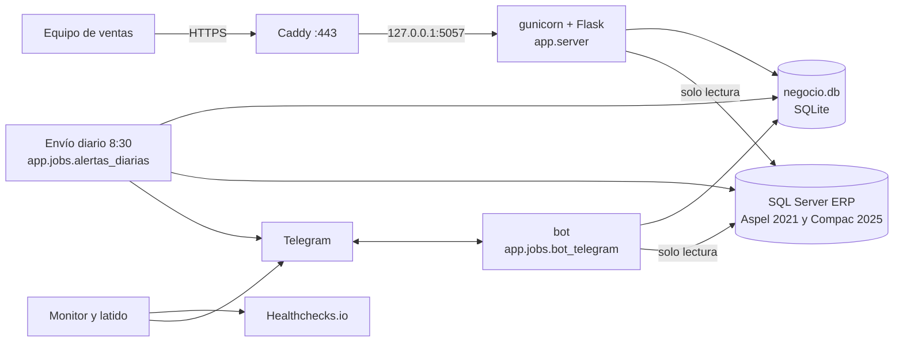

# Arquitectura

## Vista general



**Idea central.** El sistema no modifica ERP. De ERP lee las facturas; con eso y con lo que el equipo captura (vida útil, máquinas, seguimientos) calcula cuándo contactar a cada cliente.

## Estructura del código

Todo vive en el paquete `app/`, un archivo por tema, y se lanza como módulo (`python -m app.jobs.salud`). Las carpetas siguen las capas del sistema: la **web** usa **negocio** (base propia) y **erp** (lectura de ERP); **telegram** arma los mensajes; **jobs** son los procesos programados.

| Paquete | Archivos | Qué hace |
|---|---|---|
| `app/web/` | `sesion`, `usuarios`, `consultas`, `seguimientos`, `configuracion`, `resultados`, `exportaciones`, `comun` | La página y su API, un blueprint de Flask por tema. `app/server.py` solo arma la aplicación (es el punto de entrada de gunicorn). |
| `app/negocio/` | `conexion`, `catalogo`, `estados`, `seguimientos`, `resultados`, `telegram`, `seguridad`, `filtros` | Base propia (SQLite) y las reglas. `estados.py` es el modelo de estados; los plazos están ahí. `__init__.py` reexporta lo público (`from app import negocio`). |
| `app/erp/` | `conexion`, `catalogo`, `productos`, `clientes`, `compras` | Lectura de las dos bases de ERP. `compras.py` tiene `alertas_recontacto`, la lista de trabajo del día. |
| `app/telegram/` | `avisos`, `resumen` | Avisos individuales con botones; textos del resumen diario, la escalación, las ventas sin factura y la ficha de cliente. |
| `app/jobs/` | `alertas_diarias`, `bot_telegram`, `salud`, `latido`, `respaldo` | Procesos que corren solos (temporizadores de systemd y el bot). |
| `app/herramientas/` | `crear_usuario`, `crear_invitacion_telegram`, `enviar_prueba`, `datos_demo`, `vaciar_configuracion` | Administración y pruebas, a mano. |
| `app/config.py`, `app/auth.py` | | Rutas de `config/` en un solo lugar; usuarios y contraseñas. |
| `app/static/` | `index.html`, `usuarios.html`, `login.html`, `css/`, `js/` | Interfaz. El JavaScript de la página principal está dividido por pestaña (`resultados.js`, `alertas.js`, …) y se carga en ese orden; los enlaces llevan `?v=<versión>` para que el navegador baje los archivos nuevos tras cada despliegue. |

Reglas de la organización: los archivos de `web/` solo arman respuestas (la lógica está en `negocio/`, `erp/` y `telegram/`); nada usa parches de `sys.path`; ningún script ejecuta código al importarse (todos tienen `main()`).

## Bases de datos

**ERP (solo lectura)**, en el servidor SQL `192.168.0.20\SQLEXPRESS`:

| Base | Sistema | Qué se lee |
|---|---|---|
| `adERP_MX_2021` | Aspel (anterior) | Facturas de venta (conceptos listados en `LEGACY_CONCEPTOS_FACTURA`), sin notas de crédito ni devoluciones. |
| `ERP_Comercial` | Compac (actual) | Módulo «Facturas CFDi» (`ACTUAL_MODULE_ID = 21`, tipo de documento 5). |

Solo se consideran compras desde `FECHA_INICIO = 2024-01-01` y de los códigos que estén en el catálogo. Un mismo cliente puede existir en las dos bases con ids distintos; se junta por su nombre normalizado (mayúsculas y espacios), que además es la **clave del cliente** (`clave_cliente`) en la base propia.

**Base propia** (`config/negocio.db`, SQLite):

| Tabla | Contenido |
|---|---|
| `vida_util` | Meses de vida útil por filtro. |
| `maquinas` | Máquinas por cliente y filtro. |
| `filtros` | Catálogo de códigos vigilados (se sembró una vez desde el Excel). |
| `seguimientos` | Historial de contactos: cliente, código, resultado, fecha de recordatorio, nota, usuario y fecha. |
| `usuarios` | Usuarios de la página (hash de contraseña, rol admin/vendedor). |
| `intentos_login` | Bloqueo tras 5 intentos fallidos (15 min). |
| `alertas_telegram` | Cada aviso enviado (para editar el mensaje al responder y no repetirlo). |
| `telegram_espera` | Lo que el bot espera que le escriban (fecha, motivo, nota). |
| `telegram_chats`, `telegram_invitaciones` | Quién recibe avisos y los links de alta de un solo uso. |
| `historial_config` | Bitácora de cambios de vida útil y máquinas. |

Las migraciones son automáticas: `negocio.conectar()` crea las tablas y agrega las columnas que falten cada vez que se abre.

## Cómo se calcula el próximo contacto

```
próximo contacto = fecha de la última compra + (piezas ÷ máquinas × vida útil en meses) × 30.44 días
```

Solo cuenta la última compra de cada cliente y filtro. Si falta la vida útil o las máquinas, no hay fecha (`calcular_proximo_contacto` regresa `None`).

## Modelo de estados de un caso

`negocio.resolver_estado()` recibe la última compra y el último seguimiento de un cliente y filtro, y regresa `{proximo_contacto, estado, nota}`.

**Regla de oro:** el seguimiento solo cuenta si es **posterior** a la última compra. Si hay una factura más nueva, el seguimiento se ignora y el ciclo vuelve a calcularse desde esa factura. Solo el seguimiento más reciente manda; los anteriores son historial.

| Último seguimiento | Estado | Próximo contacto | ¿Alerta? |
|---|---|---|---|
| ninguno | `normal` | fórmula de arriba | Sí, si vence en ≤ 7 días |
| Pidió esperar | `pendiente` | fecha elegida | Sí, al llegar la fecha |
| No contestó | `reintentar` | seguimiento + 3 días (`DIAS_REINTENTO`) | Sí |
| Cambió de proveedor | `inactivo` | — | No |
| No aplica | `descartado` | — | No |
| Volvió a comprar (sin factura nueva), días 0–14 | `esperando_factura` | seguimiento + 15 días | Solo informativa (ver abajo) |
| Volvió a comprar (sin factura nueva), día 15 en adelante | `factura_vencida` | seguimiento + 15 días | Sí, como alerta vencida |

Constantes del ciclo de facturas en `app/negocio/estados.py`: `DIAS_PRORROGA_FACTURA = 7` y `DIAS_LIMITE_FACTURA = 15`.

`db.alertas_recontacto()` arma la lista de trabajo:
- Incluye lo vencido y lo que vence en 7 días.
- Con `incluir_esperando_factura=True` (la pestaña «Contactar hoy» y `/hoy`) agrega también los `esperando_factura` pasada la semana de prórroga; esos no son «contactar ya», por eso los avisos individuales y el resumen no los incluyen.

### Ciclo de «Volvió a comprar» sin factura

| Días desde el seguimiento | Qué ocurre |
|---|---|
| 0 a 6 | Prórroga, sin aviso. |
| 7 a 14 | Estado «esperando factura»; aparece en «Contactar hoy»; recordatorio por Telegram a los 7 y 14 días (`resumen.seleccionar_facturas`). |
| 15 en adelante | Pasa a `factura_vencida`: alerta normal con botones, resumen y escalación. |
| Llega la factura | El seguimiento se ignora y se recalcula el ciclo. |

Un seguimiento nuevo reinicia el ciclo. Los clientes cuyo nombre empieza con `DEMO - ` (datos de demostración) nunca generan avisos.

## Pestaña Resultados

`negocio.resumen_seguimientos()` agrupa los seguimientos por **caso** (cliente + filtro) con su resultado más reciente. `negocio.reclasificar_por_compras()` consulta las últimas compras en ERP (`db.ultimas_compras()`) y pasa a «Volvió a comprar» los casos con una factura más nueva que su último seguimiento (marca `por_factura` y guarda el resultado anterior en `antes`). Si ERP no responde, se muestra lo que dicen los seguimientos.

## Telegram

Dos bots distintos:

| Bot | Uso | Configuración |
|---|---|---|
| `@filtros_demo_bot` | Avisos de recontacto, botones y comandos. Lo usan `avisos.py`, `alertas_diarias.py` y el bot interactivo. | `config/telegram_config.json` |
| Bot de salud (`chequeo_servicios_bot`) | Solo alertas técnicas para administradores. | `config/salud_config.json` |

Alta de destinatarios: un administrador genera un link de un solo uso (página **Usuarios → Avisos de Telegram**). Al abrirlo, el chat queda ligado al usuario del sistema y su nombre se usa para firmar los seguimientos hechos desde Telegram (`Nombre (Telegram)`).

Los comandos `/hoy`, `/cliente` y `/ayuda` solo responden a chats dados de alta.

### Aviso inmediato

Al guardar la vida útil o las máquinas desde la página, `server._avisar_en_segundo_plano()` manda en un hilo aparte los avisos que ya toquen (máximo `MAX_AVISO_INMEDIATO = 15`). Un fallo de Telegram o de ERP nunca afecta el guardado.

### Envío diario (8:30)

`app/jobs/alertas_diarias.py` corre cuatro partes independientes: resumen (lunes a sábado), avisos individuales (repite cada `dias_entre_avisos`, 3 por defecto), ventas sin factura y escalación a administradores (alertas con más de 5 días vencidas, se repite cada 7). Si una parte falla, las demás se mandan igual y el proceso termina con error para que el monitor lo vea.

## Monitoreo

| Componente | Frecuencia | Qué vigila |
|---|---|---|
| `app.jobs.salud --monitor` | cada 2 min | Servicios, sitios por HTTPS y certificados, conexión a ERP, edad del respaldo, disco. Avisa a los administradores al confirmar un problema (2 corridas seguidas), lo recuerda cada 6 h y avisa cuando se resuelve. |
| `app.jobs.latido` | cada 1 min | Manda un latido a Healthchecks.io; si la app, Caddy o el propio monitor fallan, manda la señal de fallo. Si el servidor se apaga, Healthchecks avisa por la falta de latidos. |
| `app.jobs.salud` (sin opciones) | 8:00 | Revisión diaria; los lunes confirma «todo en orden». |

Healthchecks.io avisa a un webhook que reenvía el mensaje al bot de salud.

## Seguridad

- Sesión en cookie `Secure`, `HttpOnly`, `SameSite=Lax`; bloqueo de 15 minutos tras 5 intentos fallidos.
- Contraseñas con hash (Werkzeug); mínimo de 10 caracteres.
- Todo texto de usuarios y clientes se escapa antes de mostrarse (página y HTML de Telegram).
- Los comandos y botones de cliente de Telegram exigen un chat dado de alta.
- El usuario `filtrosapp` no tiene sudo; el despliegue lo hace un script con permiso acotado (ver OPERACION.md).
- Secretos fuera de git (`config/*.json`, `latido.url`, `secret_key.txt` están en `.gitignore`).
